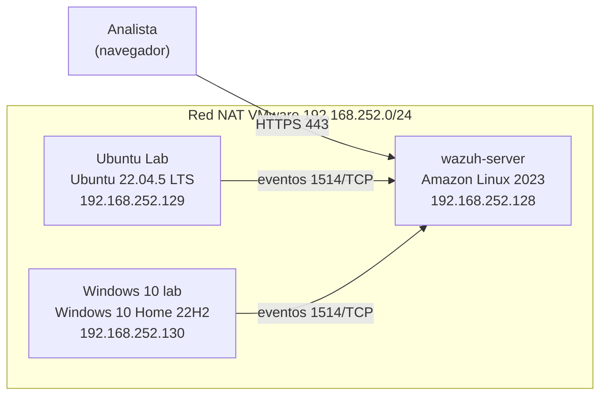
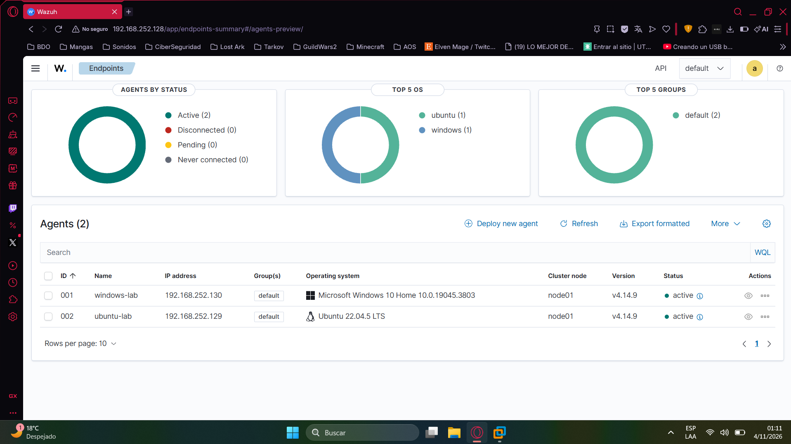

# SOC Lab con Wazuh

Laboratorio de monitoreo de seguridad armado en VMware Workstation. Simula un entorno SOC básico: un servidor Wazuh que recibe y analiza los eventos de dos endpoints (Linux y Windows).

## Arquitectura

El laboratorio tiene tres VMs en una red NAT de VMware (192.168.252.0/24). Los endpoints Ubuntu y Windows tienen el agente de Wazuh instalado y envían sus eventos al servidor, que los analiza con sus reglas y los muestra en el panel web.

### Direccionamiento

| Elemento | Valor |
|---|---|
| Red | VMnet8 (NAT), 192.168.252.0/24 |
| Puerta de enlace | 192.168.252.2 |
| wazuh-server | 192.168.252.128 |
| Ubuntu Lab | 192.168.252.129 |
| Windows 10 lab | 192.168.252.130 |

### Componentes

| VM | Sistema | Rol | RAM | CPU | Disco |
|---|---|---|---|---|---|
| wazuh-server | Amazon Linux 2023 (OVA oficial de Wazuh 4.14.9) | Manager, indexador y panel | 4 GB | 4 | 50 GB |
| Ubuntu Lab | Ubuntu 22.04.5 LTS | Endpoint Linux monitoreado | 2 GB | 2 | 25 GB |
| Windows 10 lab | Windows 10 Home 22H2 (build 19045.3803) | Endpoint Windows monitoreado | 4 GB | 2 | 50 GB |

### Flujo de datos

1. El agente de Wazuh recolecta logs y eventos del endpoint.
2. Los envía al servidor por el puerto 1514/TCP.
3. El servidor los analiza con sus reglas, genera alertas y las muestra en el panel, al que se accede por HTTPS (443).

## Cómo se armó

1. Instalé VMware Workstation Pro y descargué las ISOs y el OVA de Wazuh.
2. Importé el OVA de Wazuh y creé las VMs de Ubuntu y Windows.
3. Puse las tres máquinas en la misma red NAT y verifiqué la conectividad con ping.
4. Desplegué el agente de Wazuh en cada endpoint desde el panel.
5. Confirmé que ambos agentes figuran como **Active**.

## Resultado

## Problemas que resolví

El archivo OVA de Wazuh no me arrancaba al principio probando con 2gb de ram y 2 procesadores. así que decidí ponerle mas ram pero tampoco arrancaba empecé a investigar el por que y resulto que al tener un procesador amd y usar VMware hay que modificar el archivo .OVA con un editor de texto al final del todo y poner esta linea de comandos:

cpuid.0.eax = "0000:0000:0000:0000:0000:0000:0000:1011"
cpuid.0.ebx = "0111:0101:0110:1110:0110:0101:0100:0111"
cpuid.0.ecx = "0110:1100:0110:0101:0111:0100:0110:1110"
cpuid.0.edx = "0100:1001:0110:0101:0110:1110:0110:1001"
cpuid.1.eax = "0000:0000:0000:0001:0000:0110:0111:0001"
cpuid.1.ebx = "0000:0010:0000:0001:0000:1000:0000:0000"
cpuid.1.ecx = "1000:0010:1001:1000:0010:0010:0000:0011"
cpuid.1.edx = "0000:0111:1000:1011:1111:1011:1111:1111"
featureCompat.enable = "FALSE"

luego de eso arranque la maquina y funciono perfecto.

Por otra parte el único problema que me dio ubuntu fue que tenia que iniciar el servidor forzadamente así que use los comandos "sudo systemctl daemon-reload && sudo systemctl enable --now wazuh-agent" con eso me creo los enlaces simbólicos y así pudiendo ver la maquina en el panel de wazuh

## Próximos pasos

- [ ] Escaneos con Nmap y análisis de las alertas generadas
- [ ] Simulación de fuerza bruta por SSH y detección con Wazuh
- [ ] Monitoreo de integridad de archivos (FIM)
- [ ] Análisis de tráfico con Wireshark
- [ ] Informe de un incidente simulado

## Herramientas

VMware Workstation Pro  Wazuh  Ubuntu  Windows  Nmap  Wireshark
