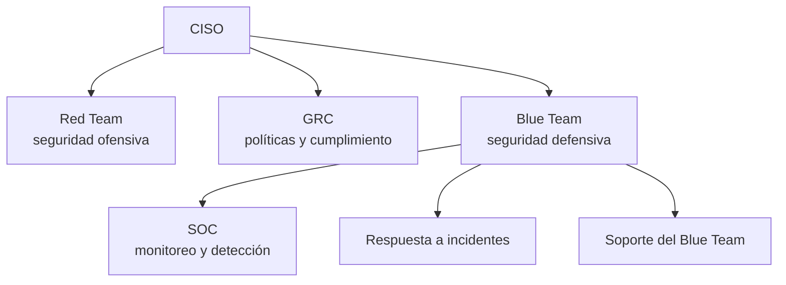
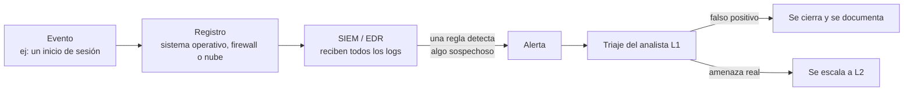

Aprendizajes: camino SOC Level 1

Notas de estudio del camino SOC Level 1 de TryHackMe. Acá resumo qué es un SOC, quién hace qué y cómo se maneja una alerta de principio a fin. Al mismo tiempo lo conecto con el laboratorio de Wazuh que armé en este mismo repo.
Progreso

[x] Junior Security Analyst Intro
[x] SOC Role in Blue Team
[x] SOC L1 Alert Triage
[ ] Core SOC Solutions
[ ] Resto del camino

---
1. Dónde está el SOC dentro de una empresa
En una empresa chica, el área de TI se ocupa de la seguridad. En una empresa grande hay un CISO que supervisa varios equipos, cada uno con una tarea distinta:

Red Team: ataca los sistemas a propósito para encontrar fallas antes que un atacante real.
GRC: se asegura de que la empresa cumpla políticas y normas, como PCI DSS para datos de tarjetas.
Blue Team: defiende. Monitorea todo el tiempo e intenta responder rápido a cada ataque.
Hay también roles más especializados que suelen pedir bastante experiencia: analista forense digital, analista de inteligencia de amenazas, ingeniero de AppSec e investigador de amenazas de IA.
2. Quién hace qué en el equipo
Rol	Qué hace
Analista SOC L1	Primera línea. Revisa las alertas, distingue las reales de los falsos positivos y escala las reales
Analista SOC L2	Recibe lo que escala L1, investiga a fondo y remedia
Ingeniero SOC	No analiza alertas: configura herramientas y reglas para que las alertas lleguen con la información necesaria
Gerente SOC	Informa los resultados a la dirección y controla la velocidad y la calidad del triaje
Respondedor de incidentes (CERT)	Interviene cuando el incidente está confirmado y es grave. No se trabaja con él a diario
Auditor GRC	Verifica el cumplimiento de normas
Investigador de amenazas	Estudia a los grupos atacantes y sus tácticas (por ejemplo, FIN7)
Pentester	Busca vulnerabilidades atacando de forma controlada
El ejercicio interactivo de la sala consiste en asignar cada rol a un escenario (alerta de fuerza bruta, phishing, ransomware, auditoría, etc.). Lo más útil que me dejó fue razonar qué hace cada rol en el día a día, más que memorizar.
3. De un evento a una alerta
Un SOC recibe millones de registros por día. Si los analistas tuvieran que mirarlos todos, sería imposible. Por eso existen las alertas: las herramientas filtran el ruido y avisan solo cuando un evento, o una secuencia de eventos, parece sospechoso.

Así, en lugar de millones de eventos crudos, el analista clasifica unas docenas de alertas por día.
4. Herramientas de un SOC
Tipo	Para qué sirve	Ejemplos
SIEM	Centraliza los logs y gestiona las alertas. Es la base de la mayoría de los SOC	Splunk Enterprise Security, Elastic
EDR / NDR	Detectan amenazas en los equipos (EDR) y en la red (NDR)	Microsoft Defender, CrowdStrike
SOAR	Reúne alertas de varias herramientas y automatiza respuestas. Lo usan SOC más grandes	Splunk SOAR, Cortex XSOAR
ITSM	Gestión de tickets y casos	Jira, TheHive
5. Cómo elegir qué alerta atender primero
Cada SOC define sus propias reglas, pero el enfoque más común es este:
Filtrar: tomar solo alertas nuevas. No repetir trabajo sobre una que ya revisó o está investigando otra persona.
Ordenar por gravedad: crítica, alta, media y baja. Las críticas tienen más probabilidad de ser amenazas reales y de causar más daño.
Ordenar por antigüedad: dentro de la misma gravedad, primero las más viejas, porque ese atacante ya lleva más tiempo dentro.
6. Caso práctico: acceso exitoso desde una IP no autorizada
Pregunta que me hice: si un log crítico muestra que alguien logró entrar al sistema desde una IP no autorizada, ¿qué hago primero como analista L1?
Verificar el origen. Investigar la IP (ubicación, reputación) para descartar un falso positivo. Por ejemplo, el usuario pudo conectarse desde otro lugar.
Confirmar con el usuario, si es posible, si ese acceso fue suyo.
Escalar. Si el origen es sospechoso y el usuario no lo reconoce, el acceso ya fue exitoso, así que es un posible incidente. Se avisa al líder del SOC y a L2 / respuesta a incidentes.
Contener, siguiendo el procedimiento del equipo: bloquear la IP en el firewall, cerrar las sesiones y restablecer las credenciales de la cuenta afectada.
Revisar el alcance. Buscar en otros logs si, mientras estuvo dentro, el atacante creó archivos, cambió reglas o hizo otros movimientos.
Documentar todo lo observado y lo hecho.
Nota: en muchos SOC el L1 no ejecuta el bloqueo por su cuenta, sino que lo pide o lo hace con aprobación.
7. Conexión con mi laboratorio
En mi laboratorio de Wazuh se ve este mismo ciclo en pequeño: los agentes de Ubuntu y Windows generan eventos, los envían al servidor de Wazuh, que los analiza con sus reglas y los muestra en el panel. Lo que sigue en mi plan para estas semanas, es provocar eventos a propósito (escaneos con Nmap desde otra consola fuera del rango, ataques por fuerza bruta por SSH) y practicar el triaje sobre las alertas que genere.
Próximos pasos
Terminar el módulo SOC Team Internals y seguir con Core SOC Solutions
Documentar las alertas de mi laboratorio como casos de triaje
Escribir los writeups de la semana siguiente
